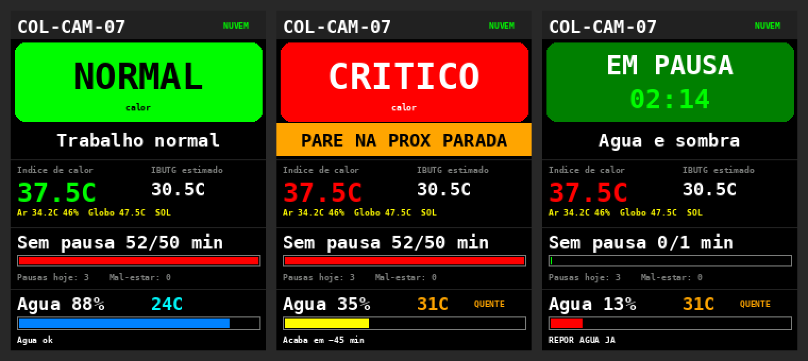
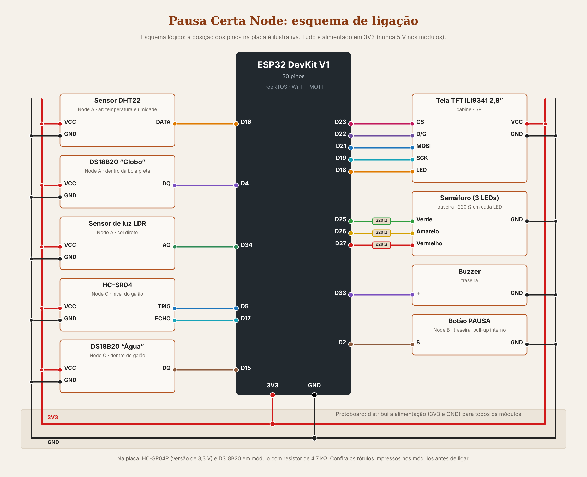

<h1 align="center">Pausa Certa</h1>
<p align="center"><em>A pausa na hora certa, para quem corre atrás do caminhão.</em></p>

Estação de **estresse térmico** no caminhão da coleta de lixo. Um ESP32 mede o calor (ar, umidade, globo negro e sol), calcula o
**índice de calor** e acende um **semáforo na traseira**, visível para os coletores, com a ação na **tela da cabine**. Um **botão** registra as
pausas da equipe e um sensor no **galão** avisa antes de a água acabar. Os dados vão por MQTT para o **FIWARE**, com histórico e comandos de volta.

Projeto da **Global Solution 2026.2 (CitizenTech)**, Engenharia de Software, FIAP. Este repositório é a parte de **Edge Computing**.
Estrutura baseada no **WineGuard**, projeto anterior do grupo.

## Sumário

1\. [Ficha da CitizenTech](#ficha-da-citizentech) · 2. [O problema](#o-problema) · 3. [A solução](#a-solução) · 4. [Status](#status-do-projeto)
5\. [Demonstração](#demonstração) · 6. [Arquitetura](#arquitetura) · 7. [O Node](#o-pausa-certa-node-hardware) · 8. [Como o Node avisa](#como-o-node-avisa)
9\. [Protocolo](#protocolo-mqtt) · 10. [Plataforma FIWARE](#plataforma-fiware) · 11. [Dashboard](#dashboard) · 12. [Como rodar](#como-rodar)
13\. [Estrutura](#estrutura-do-repositório) · 14. [Limitações](#limitações-e-evolução) · 15. [Créditos](#créditos) · 16. [Integrantes](#integrantes)

## Ficha da CitizenTech

| | |
|---|---|
| **Nome da CitizenTech** | Pausa Certa |
| **Cidade e bairro** | São Paulo (SP). Sugestão de rota: Paraisópolis e Morumbi (ver `docs/Ficha_CitizenTech_Pausa_Certa.pdf`). *Escolha final do grupo* |
| **Cidadão beneficiado** | Gari da coleta de lixo de empresa contratada pela prefeitura, que corre atrás do caminhão e ergue sacos ao sol, com o calor mais forte por volta do meio-dia |
| **Problema, em uma frase** | Os garis da coleta trabalham sob calor forte sem pausas além do intervalo obrigatório, porque não há um sinal objetivo de quando parar e eles têm receio de "perder tempo" diante da chefia |
| **Como funciona** | Uma estação com ESP32 no caminhão mede o calor (ar, umidade, globo negro e sol), calcula o índice de calor e acende um semáforo na traseira, visível para os coletores, com a ação no display da cabine ("PAUSA NA SOMBRA"). O botão de pausa registra as pausas da equipe e o sensor do galão avisa a reposição de água antes de acabar. Tudo funciona sem internet e sincroniza na garagem. A empresa acompanha cada equipe num painel web e recebe um relatório semanal |
| **O que cada parte faz** | **Python:** calculadora de estresse térmico, regime de pausas da empresa e relatório por equipe. **Matemática:** modelos do índice de calor e do aquecimento do globo, com derivada e limites. **Edge:** estação ESP32 com sensores, semáforo, tela e envio MQTT para o FIWARE. **Front-end:** painel React para o encarregado, com estado das equipes e pontos de apoio. **STXD:** requisitos, regras de negócio e protótipo a partir de entrevistas com três garis da coleta. **Pitch:** história do Sandro, do Jackson e de um coletor anônimo, impacto e modelo de negócio. **Web:** CRUD de equipes, regimes e pontos de apoio, previsão do tempo (Open-Meteo), CEP (ViaCEP) e dados do Orion |
| **Link do repositório** | https://github.com/enzopereira1701/pausacerta |
| **Indicador de impacto** | Pausas recomendadas × pausas realizadas por equipe e por turno; minutos em estado CRÍTICO ou PERIGO sem pausa; e rotas concluídas por turno antes e depois das pausas organizadas |
| **ODS conectados** | ODS 8 (8.8, trabalho seguro), ODS 3 (3.9 e 3.d, saúde), ODS 13 (13.1, adaptação ao clima), ODS 10 (redução das desigualdades) |

> As falas do Sandro e do Jackson (com o primeiro nome) e de um coletor anônimo (sem identificação), garis entrevistados em 9/11/2026, são usadas com autorização deles. Sobrenome, empresa e local não são divulgados.

## O problema

Os garis da coleta trabalham no sol do meio-dia, correndo e erguendo peso, e quase nunca param por causa do calor:

> "A gente nunca para porque tá quente ou porque cansou. [...] Eu, quando canso, diminuo um pouco o ritmo, mas nunca paro." — **Jackson**

> "Sabemos que o patrão ficaria irritado em perder tempo." — **Sandro**

A água do galão do caminhão esquenta e acaba antes da reposição ("ela já tinha acabado muito antes da parada na garagem", Jackson). E a coleta é
por rota: parar no meio atrasa a volta para casa (coletor anônimo). Falta um **sinal objetivo**, que a empresa reconheça, de quando parar.

## A solução

| Parte | O que é |
|---|---|
| **Pausa Certa Node** | ESP32 no caminhão com três módulos: **A, calor** (DHT22, globo negro com DS18B20, LDR); **B, pausas** (botão na traseira); **C, água** (HC-SR04 e DS18B20 no galão). Avisa por semáforo, buzzer e tela colorida |
| **Plataforma (FIWARE)** | Recebe as leituras por MQTT, guarda o último valor (Orion) e o histórico (STH-Comet) e leva os comandos de volta ao Node |
| **Dashboard de Edge** | Estado da equipe agora (semáforo e tela da cabine), histórico em gráficos e comandos ao Node |

O Node **recomenda** a pausa na **próxima parada natural** da rota e **nunca bloqueia** uma pausa. Quem define o regime é a empresa com a
segurança do trabalho, pelo comando `setRegime`. Sem internet, o Node continua avisando e reenvia os dados na garagem.

## Status do projeto

Atualizado em 10/11/2026.

| Parte | Estado |
|---|---|
| Firmware 0.2 (Nodes A, B e C) | **Pronto**, rodando no Wokwi; compila sem erros nem avisos |
| Diagrama do Wokwi | **Pronto**, nenhum fio de sinal cruzando outro |
| FIWARE na AWS (`provisionar.sh`) | **Pronto e testado**: telemetria no Orion, comando `setRegime` com resposta OK do Node, histórico no STH-Comet |
| Dashboard de Edge | **Pronto**: funciona com o simulador do navegador e com o backend |
| Backend (FastAPI) | **Pronto**, com 27 testes; testado com o dashboard e um FIWARE de teste. Falta subir na instância (12/11) |
| Vídeo | **A gravar** (14/11) |

## Demonstração

- **Simulação no Wokwi:** https://wokwi.com/projects/480299618436453377
- **Vídeo:** [`video/link.md`](video/link.md)

<p align="center">
  
</p>
<p align="center"><em>Prévia da tela da cabine (ILI9341): estado na cor do semáforo, ação, leituras, pausas e galão.</em></p>

## Arquitetura

Três camadas, como pede a atividade:

| Camada | O que tem | Como se comunica |
|---|---|---|
| **1. Dispositivo (IoT)** | Pausa Certa Node: ESP32 com sensores, semáforo, buzzer e tela. FreeRTOS: uma tarefa para semáforo, buzzer e botão; outra para a tela; o `loop()` para rede e sensores | MQTT (Ultralight 2.0) pelo Wi-Fi, até o Mosquitto (1883) |
| **2. Plataforma (Back-end)** | Mosquitto, IoT Agent Ultralight (4041), Orion (1026), STH-Comet (8666) e MongoDB, em Docker na AWS | O IoT Agent traduz MQTT para NGSI-v2; o Orion avisa o STH-Comet, que guarda o histórico |
| **3. Aplicação** | Dashboard de Edge (React) e backend (FastAPI, porta 8001). Os painéis de Front-end e Web leem a mesma entidade | HTTP/REST |

Os dados **sobem** (telemetria e histórico) e os comandos **descem** (regime, limites, galão, identificar) pelo mesmo caminho.

## O Pausa Certa Node (hardware)



| Componente | Função | Pino |
|---|---|---|
| DHT22 | Temperatura e umidade do ar | D16 |
| DS18B20 "Globo" | Termômetro de globo negro (calor do sol e do asfalto) | D4 |
| LDR | Sol direto | D34 |
| Botão PAUSA | Um clique inicia e encerra a pausa | D2 |
| HC-SR04 | Nível do galão | TRIG D5, ECHO D17 |
| DS18B20 "Água" | Temperatura da água | D15 |
| Semáforo (3 LEDs + 220 Ω) | Estado, visível da traseira | D25, D26, D27 |
| Buzzer | Bipe quando algo muda | D33 |
| Tela ILI9341 2,8" (SPI) | Painel da cabine | CS D23, D/C D22, MOSI D21, SCK D19, LED D18 |

Detalhes em [`hardware/esquema-ligacao.md`](hardware/esquema-ligacao.md), [`hardware/lista-de-materiais.md`](hardware/lista-de-materiais.md)
e [`hardware/firmware/README.md`](hardware/firmware/README.md).

## Como o Node avisa

| Situação | Semáforo (traseira) | Tela (cabine) | Bipes |
|---|---|---|---|
| NORMAL (índice < 27 °C) | Verde | Trabalho normal | 1 curto ao descer |
| ATENÇÃO (27 a 32 °C) | Amarelo | Agua e sombra | 1 |
| CRÍTICO (32 a 41 °C) | Vermelho | PAUSA NA SOMBRA | 2 |
| PERIGO (≥ 41 °C) | Vermelho piscando | SUSPENDER PESADO | 3 |
| Pausa recomendada | Vermelho + amarelo | PARE NA PROX PARADA | 1 longo |
| Em pausa | Verde piscando | EM PAUSA mm:ss | 1 ao iniciar, 2 ao registrar |
| Falha do DHT22 | Amarelo piscando | Confira o DHT22 | 1 curto |
| Água acabando | (não muda o semáforo) | REPOR AGUA JA | 2 longos |

Faixas do **índice de calor da NOAA**, com **histerese de 1 °C** e média móvel de 6 leituras. O IBUTG aparece como **estimativa**
(o ESP32 não mede o bulbo úmido natural). Fontes em [`docs/referencias.md`](docs/referencias.md).

## Protocolo (MQTT)

| Tópico | Sentido | Conteúdo |
|---|---|---|
| `/pausacerta/pcn001/attrs` | Node → nuvem | Telemetria |
| `/pausacerta/pcn001/cmd` | Nuvem → Node | Comandos |
| `/pausacerta/pcn001/cmdexe` | Node → nuvem | Resposta do comando |

```
Telemetria  t|34.2|h|46.0|g|47.5|ic|37.5|ib|30.5|sol|true|st|CRITICO|msp|52|pz|3|ep|false|pr|true|me|0|ga|35|ta|31.0|aa|45|sa|REPOR|ts|...|fw|0.2

Comandos    pcn001@<comando>|<parametros>
            setLimites|27,32,41   setRegime|300,90,50   setGalao|5,45,30   setIntervalo|60   identify|
```

No Orion, a entidade é **`EquipeCampo:COL-CAM-07`** (service `pausacerta`, servicepath `/coleta`). Todos os atributos em
[`docs/api-contrato.md`](docs/api-contrato.md).

## Plataforma FIWARE

Roda em Docker numa instância do AWS Learner Lab, com a base do professor (a mesma usada no WineGuard).
[`fiware/scripts/provisionar.sh`](fiware/scripts/provisionar.sh) cadastra o service group, o Node (18 atributos e 5 comandos) e a assinatura do
histórico. [`fiware/scripts/testa_fiware.sh`](fiware/scripts/testa_fiware.sh) confere as três coisas: a entidade mudando, um comando indo e voltando
e o histórico.

> **Lição do WineGuard:** o dispositivo é cadastrado **com a `apikey`**; sem ela, o IoT Agent cria outro dispositivo sozinho, sem o mapeamento dos atributos.

## Dashboard

Painel de Edge em React, separado do painel do encarregado de Front-end e Web. Telas: **Início**, **Painel** (o semáforo e a tela da cabine
como estão agora, calor, pausas e água), **Histórico** (gráficos do STH-Comet) e **Comandos** (regime, limites, galão, intervalo e identificar,
com a confirmação do Node). Funciona sem a AWS com um simulador no navegador. Detalhes em [`dashboard/README.md`](dashboard/README.md);
prompts das imagens em [`docs/prompts-imagens.md`](docs/prompts-imagens.md).

## Como rodar

### 1. Simulação (Wokwi)

Abra https://wokwi.com/projects/480299618436453377 e clique em Play. Roteiro de testes em [`simulacao/wokwi.md`](simulacao/wokwi.md).
Para montar do zero: abas `sketch.ino`, `diagram.json`, `libraries.txt` (nome exato) e `config.h` (cópia do `config.example.h`).

### 2. FIWARE na AWS

Na instância, com a base do professor em `~/fiware`:

```bash
cd ~/fiware && sudo docker compose up -d
bash provisionar.sh        # uma vez
bash testa_fiware.sh       # com o Wokwi rodando
```

No `config.h` do Wokwi, `MQTT_BROKER` = IP público da instância (**muda a cada sessão do lab**). Passo a passo em
[`docs/manual-instalacao.md`](docs/manual-instalacao.md).

### 3. Dashboard

```bash
cd dashboard
npm install
cp .env.example .env      # VITE_USE_MOCK=true usa o simulador do navegador
npm run dev
```

Para ligar ao FIWARE de verdade: suba o backend ([`backend/README.md`](backend/README.md)) e, no `.env` do dashboard,
`VITE_USE_MOCK=false` e `VITE_API_URL=http://<IP da instância>:8001`.

## Estrutura do repositório

```
pausacerta/
├── README.md
├── backend/                    API FastAPI entre o dashboard e o FIWARE (app/, tests/, Dockerfile)
├── dashboard/                  dashboard de Edge em React (Vite + Tailwind)
├── docs/
│   ├── api-contrato.md         telemetria, comandos, entidade e histórico
│   ├── decisoes.md             decisões e lições aprendidas
│   ├── referencias.md          NOAA, Stull, NR-09, dados de contexto
│   ├── manual-instalacao.md    Wokwi e FIWARE na AWS, passo a passo
│   ├── roteiro-video.md        roteiro do vídeo de até 7 min
│   ├── prompts-imagens.md      prompts para gerar as fotos e o logo
│   ├── ficha.html, Ficha_CitizenTech_Pausa_Certa.pdf
│   ├── imagens/                prévia da tela e conferência de cruzamentos do diagrama
│   └── prints/                 telas para o README e o vídeo
├── fiware/
│   ├── scripts/provisionar.sh, testa_fiware.sh
│   └── docker-compose.backend.yml   serviço do backend (a partir do dashboard)
├── hardware/
│   ├── esquema-ligacao.md, esquema-ligacao.png (e .svg)
│   ├── lista-de-materiais.md
│   ├── fotos/                  (se o grupo montar na bancada)
│   └── firmware/pausacerta_node/   .ino e config.example.h
├── simulacao/                  Wokwi (diagram.json, libraries.txt, wokwi.md)
├── tools/                      geradores do diagram.json, do esquema de ligação e da prévia da tela
└── video/link.md
```

## Limitações e evolução

- **IBUTG estimado**, não medido pela NHO 06. O sistema faz triagem: não diz "insalubre" nem "dentro da norma".
- Com o caminhão andando, o vento esfria o globo e a água balança: as leituras válidas são as das paradas.
- O regime padrão é um **exemplo**; a empresa define com a segurança do trabalho.
- **MQTT sem usuário, senha e TLS**, e FIWARE sem autenticação: é uma prova de conceito.
- O IP do Learner Lab muda a cada sessão e é trocado à mão no `config.h`.
- O contador de pausas zera quando a data muda (precisa de NTP); sem rede, zera ao ligar o caminhão.

Evolução: GPS para cruzar o calor com a rota e os pontos de apoio, MQTT com TLS, WiFiManager e um Node por coletor (pulseira).

## Créditos

- **FIWARE Descomplicado** e **FIWARE Smart Lamp**, do Prof. Fábio H. Cabrini: base da plataforma e do protocolo.
- **WineGuard** (marcha.dev): estrutura do repositório, do firmware e dos scripts.
- Entrevistas: Sandro, Jackson e um coletor anônimo, garis da coleta, em 9/11/2026, com autorização.
- Desenvolvido com apoio de assistentes de IA (Claude, da Anthropic) em planejamento, código e documentação. O grupo testou o que está descrito como "pronto".

## Integrantes

| Nome | RM |
|---|---|
| Enzo Borgo Pereira | RM572529 |
| Raphael Mascarenhas Lima | RM572313 |
| Guilherme Pimentel Vilela | RM569177 |
| Vinícius Campestrini Rodado | RM570703 |
| Vinícius Shoiti Rios Honda | RM569744 |
