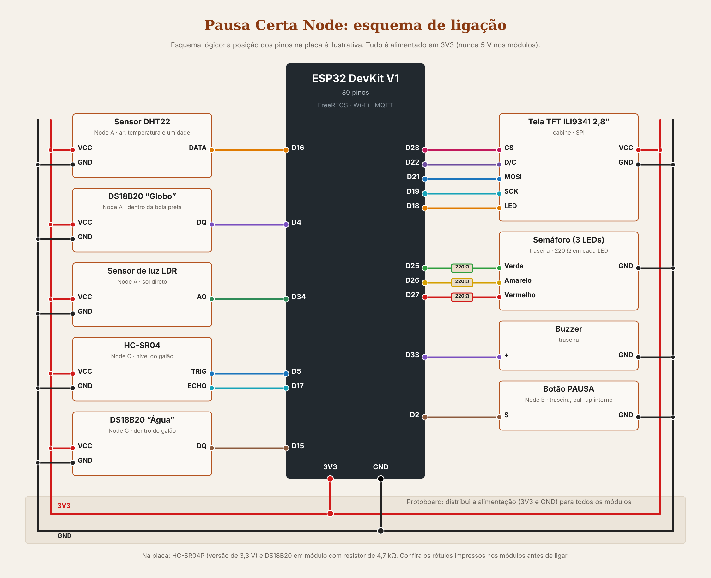

# Esquema de ligação do Pausa Certa Node

O desenho é **lógico**: mostra quem liga em quem, e não a posição física dos pinos na placa. Gerado por `tools/gera_esquema.py`
(também em `esquema-ligacao.svg`, que não perde qualidade no zoom).

**No Wokwi** o diagrama (`simulacao/diagram.json`) é gerado por `tools/gera_diagrama.py`, que também salva uma conferência dos fios em
`docs/imagens/previa_diagrama.png`. Sensores de um lado, sinalização do outro, alimentação em barramentos por cima e fios em ângulo reto. **Nenhum fio de sinal cruza outro**; os 4 cruzamentos que restam são descidas do 3V3 sobre o barramento de GND.

Tudo em **3V3**. **Nunca ligue 5 V nos módulos**: os pinos do ESP32 não toleram 5 V (por isso o HC-SR04P, de 3,3 V, na placa).

## Tabela de ligações

| Módulo | Pino do módulo | Liga em | Onde fica no caminhão | Observação |
|---|---|---|---|---|
| **DHT22** | VCC / GND / DATA | 3V3 / GND / **D16 (RX2)** | Lateral, ao sol | Temperatura e umidade do ar |
| **DS18B20 "Globo"** | VCC / GND / DQ | 3V3 / GND / **D4** | Dentro de uma bola preta fosca, na lateral | Termômetro de globo. Módulo com resistor de 4,7 kΩ |
| **LDR** (módulo) | VCC / GND / AO | 3V3 / GND / **D34** | Lateral, voltado para cima | Sol direto. D34 é só entrada (ADC1) |
| **Botão PAUSA** | um lado / outro | **D2** / GND | Traseira, ao alcance dos coletores | Pull-up interno e interrupção |
| **HC-SR04** | VCC / GND / TRIG / ECHO | 3V3 / GND / **D5** / **D17 (TX2)** | Tampa do galão | Nível da água |
| **DS18B20 "Água"** | VCC / GND / DQ | 3V3 / GND / **D15** | Dentro do galão | À prova d'água, módulo com resistor |
| **LED verde** | ânodo (por 220 Ω) / cátodo | **D25** / GND | Traseira | NORMAL, em pausa (piscando) |
| **LED amarelo** | ânodo (por 220 Ω) / cátodo | **D26** / GND | Traseira | ATENÇÃO, falha (piscando) |
| **LED vermelho** | ânodo (por 220 Ω) / cátodo | **D27** / GND | Traseira | CRÍTICO, PERIGO (piscando) |
| **Buzzer** | + / − | **D33** / GND | Traseira | No Wokwi, `tone()`; na placa, buzzer ativo |
| **Tela ILI9341 2,8"** (SPI) | VCC / GND / CS / D/C / MOSI / SCK / LED | 3V3 / GND / **D23** / **D22** / **D21** / **D19** / **D18** | Cabine, para o motorista | RST livre (reset por software); na placa, RST no 3V3 |

## Por que estes pinos

- O SPI da tela usa pinos escolhidos (`SPI.begin(19, -1, 21, 23)`), não os padrão, para a tela ficar de um lado só da placa sem cruzar os sensores.
- D34 é ADC1, que funciona com o Wi-Fi ligado (o ADC2 não).
- D2 tem interrupção e pull-up interno; um clique basta.
